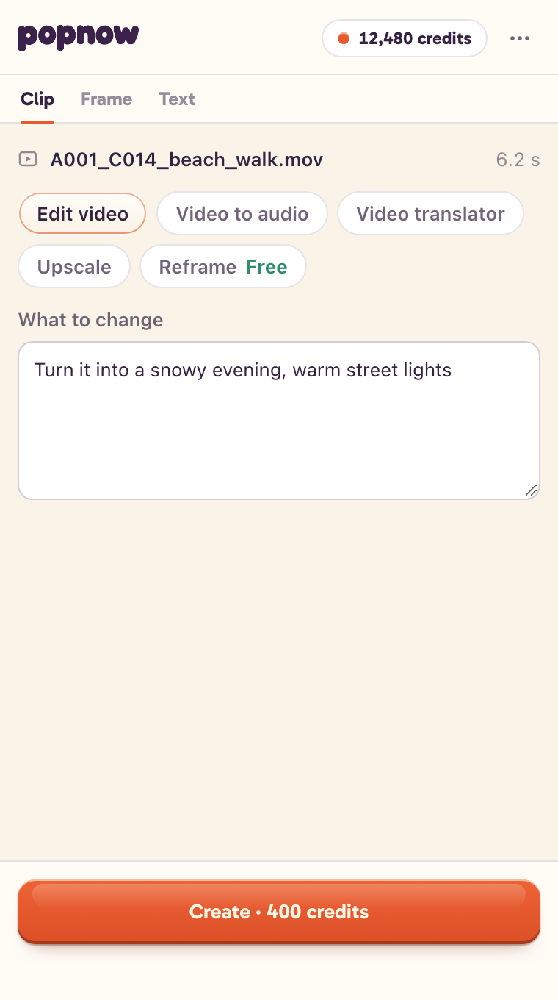
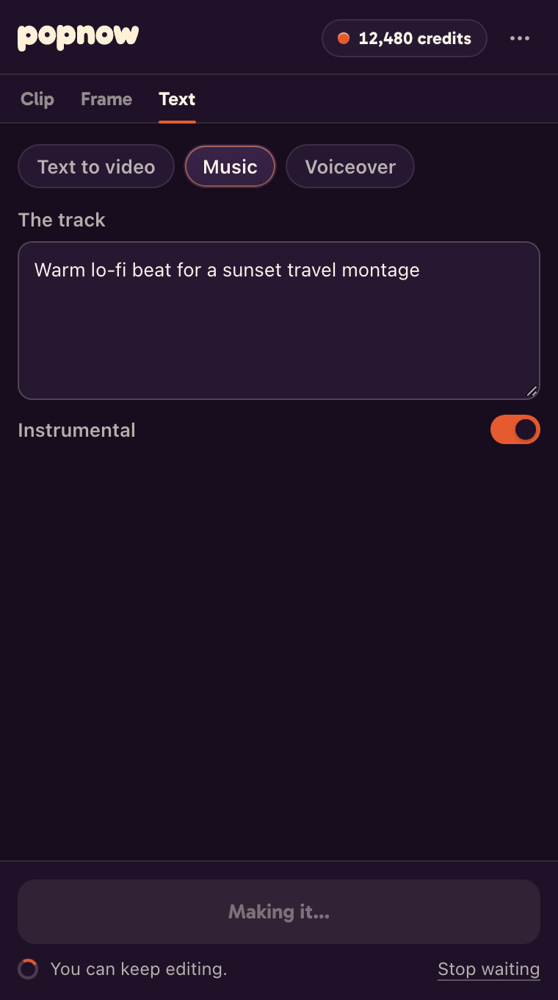

# PopNow for DaVinci Resolve

Create in your timeline with your PopNow account. Edit a clip, add sound to it, translate it,
upscale or reframe it; turn the current frame into a new picture or a video; make video, music
and voiceovers from text. Results land in the media pool and on a new track, lined up with the
clip or the playhead.

 

## Two ways to use it

| | Workflow Integration plugin | Script |
|---|---|---|
| Resolve edition | **Studio** 19.0.2 or later (Workflow Integrations are a Studio feature) | Studio, and free editions that still run Python scripts |
| Where | Workspace > Workflow Integrations > PopNow | Workspace > Scripts > PopNow |
| Clip | Edit video, Video to audio, Video translator, Upscale, Reframe (free) | Video to audio |
| Frame | Edit image, Image to video | Edit image, Image to video |
| Text | Text to video, Music, Voiceover | — |
| Balance | ✓ | ✓ |

About the free edition: Blackmagic turned off the script window toolkit (UIManager) in the free
edition from 19.1, and moved Python scripting to Studio in 21.1. So on free 19.1 to 21.0 the
script opens its controls as a page in your browser instead (served from 127.0.0.1, only on your
computer); on free 21.1 and later it can't run.

## Install

1. Download `popnow-davinci-<version>.zip` and unzip it. Quit DaVinci Resolve.
2. macOS: `./install.sh` (asks for your password to put the plugin in the shared plugins folder).
   Script only: `./install.sh --script`.
   Windows: `.\install.ps1` in PowerShell as Administrator, or `.\install.ps1 -ScriptOnly`.
3. Start Resolve and open PopNow from the Workspace menu.

The plugin uses Resolve's own `WorkflowIntegration.node` from your Resolve install, so nothing
from Blackmagic is bundled here. The script needs Python 3.6 or later installed for Resolve.

## How it works

- **Sign in** opens popnow.ai in your browser. It comes back to the panel on `127.0.0.1`
  (OAuth with PKCE). Your sign-in is kept in a file only you can read
  (`~/Library/Application Support/PopNow/davinci-resolve.json`, or `%APPDATA%\PopNow` on
  Windows); the plugin and the script share it. **Sign out** in the ⋯ menu removes it.
- **Clip** works on the clip under the playhead on the top video track (Resolve's scripting API
  has no "selected clips" call). Its source file is sent to your PopNow account; long source
  files take longer to send.
- **Frame** exports the frame under the playhead as a PNG and sends that.
- **The price is on the button.** Clip and frame actions show `Get price` first; text actions
  price themselves as you type. Nothing is charged until you click `Create · N credits`, and the
  run never goes above that number. If PopNow's price changed in between, nothing starts and the
  new price goes on the button.
- **Not enough credits**: the button turns grey and **Get credits** opens popnow.ai/pricing.
- **Video translator** asks you to confirm the face and voice are yours or that you have
  permission, and that nobody in it is under 18. PopNow never ticks that box for you.
- **Stop waiting** only stops the panel from waiting. The job keeps going on PopNow, and the
  result is saved to your library (popnow.ai/assets).
- Results are saved to `~/Movies/PopNow` (Windows: `Videos\PopNow`), imported into the **PopNow**
  bin, and placed on a new track.

Prices are the same as on popnow.ai and come out of the same credits.

## Develop

```bash
npm install
npm test               # plugin core against a fake PopNow (vitest)
npm run test:script    # script core against a fake PopNow (unittest)
npm run typecheck
npm run package        # build/ai.popnow.resolve and dist/popnow-davinci-<version>.zip
node scripts/screenshots.mjs   # docs/screenshots, headless Chrome with a fake host
```

Layout:

- `src/core/` — sign-in (`oauth.ts`), MCP client (`mcp.ts`), uploads (`upload.ts`), prices and
  runs (`flow.ts`), the actions (`actions.ts`) and the panel controller (`panel.ts`). No Electron,
  no Resolve: everything here is tested.
- `src/host/resolve.ts` — the only code that calls Resolve. Checked by hand with
  [docs/MANUAL-QA.md](docs/MANUAL-QA.md).
- `src/main.ts` — Electron main process; the window is sandboxed with context isolation and
  reaches it only through `plugin/preload.js`.
- `plugin/` — manifest, page, styles, fonts, images.
- `script/PopNow.py` — the script, standard library only.

## License

MIT. Gabarito font: SIL Open Font License (`plugin/fonts/OFL.txt`).
